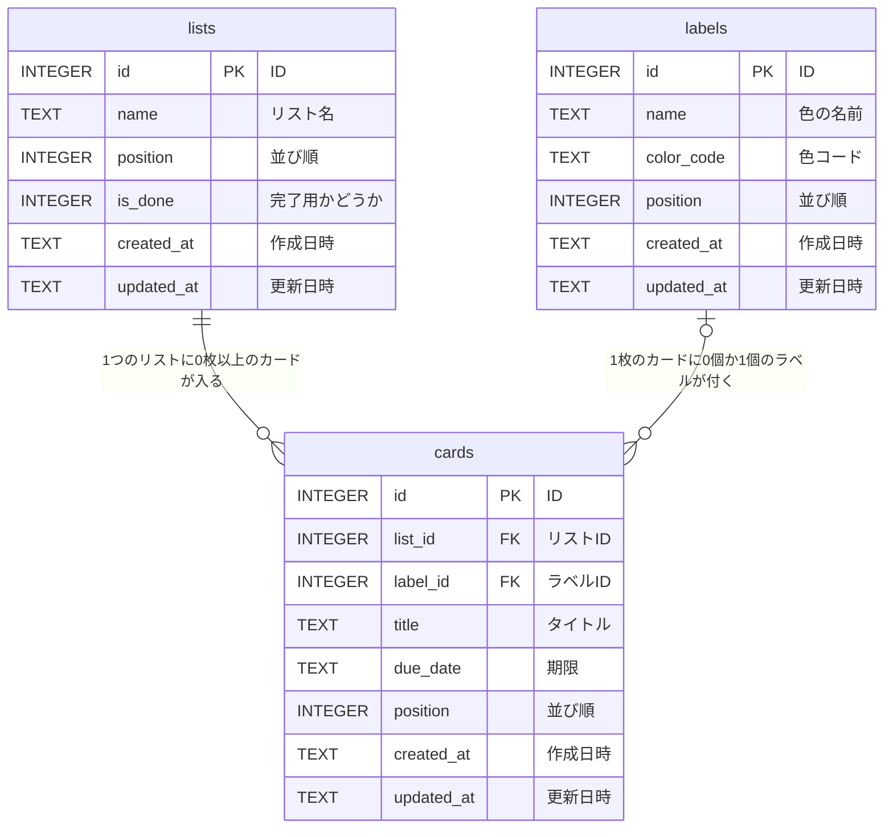

# タスク管理アプリ ER図

[← 要件定義書に戻る](requirements.md)

## 文書情報

| 項目 | 内容 |
|---|---|
| 文書名 | タスク管理アプリ ER図 |
| 版 | 1.0 |
| 作成日 | 2026-11-03 |

## 改訂履歴

| 版 | 日付 | 内容 |
|---|---|---|
| 1.0 | 2026-11-03 | 要件定義書 v1.1 の「5. データ設計（ER図）」を分割して作成 |

---

## 1. データのまとまり（エンティティ）

| まとまり | 保存する内容 |
|---|---|
| リスト（lists） | リスト名、並び順、完了用かどうか |
| カード（cards） | タイトル、期限、ラベル、どのリストに入っているか、並び順 |
| ラベル（labels） | 5色（赤・黄・緑・青・紫）の色の名前と色コード |

## 2. DBに保存しないもの

| データ | 理由 |
|---|---|
| チェックボックスの選択状態 | 削除するまでの一時的なものなので、画面の中だけで持つ |
| ボード | 1つしかないため |

## 3. ER図

**図の読み方**

| つながり | 意味 |
|---|---|
| リスト 1 ― 0以上 カード | 1つのリストには、カードが0枚以上入る。カードは必ずどれか1つのリストに入る |
| ラベル 0か1 ― 0以上 カード | 1枚のカードには、ラベルが0個か1個付く。1つのラベルは、たくさんのカードに使われる |

- PK（主キー）：その表の中で、行を区別するための番号
- FK（外部キー）：他の表の行を指す番号
- 項目の詳しい内容は [データベース設計書](database-design.md) を参照

## 4. 主な項目

| リスト（lists） | カード（cards） | ラベル（labels） |
|---|---|---|
| ID | ID | ID |
| リスト名 | リストID（どのリストに入っているか） | 色の名前 |
| 並び順 | ラベルID（どのラベルが付いているか） | 色コード |
| 完了用かどうか | タイトル | 並び順 |
| 作成日時 | 期限 | |
| 更新日時 | 並び順 | |
| | 作成日時 | |
| | 更新日時 | |

## 5. 設計の方針

| 項目 | 方針 | 理由 |
|---|---|---|
| ラベル | ラベル表を作り、カードは「ラベルID」を持つ | 表と表のつながりで管理でき、将来ラベルに名前を付けるときも、ラベル表に項目を足すだけで済むため |
| 完了用リスト | リスト表に「完了用かどうか」の項目を持たせる（完了用なら1、それ以外は0） | シンプルなため |
| 削除 | DBからデータを完全に消す（物理削除） | シンプルなため |
| リストの削除 | リストを削除したときは、中のカードもDBから一緒に消す | カードは必ずどれか1つのリストに入るため |
| 作成日時・更新日時 | すべての表に持たせる（画面には表示しない） | いつ作った・直したかを記録するため |
