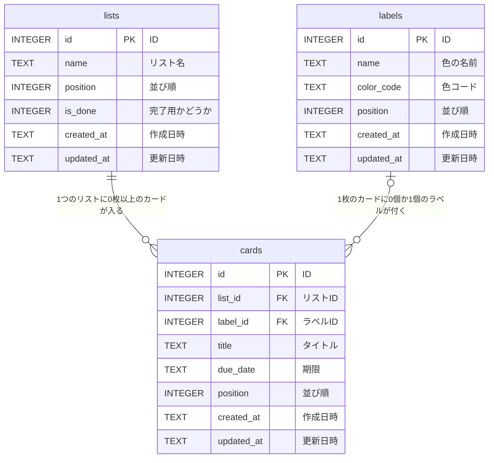

# タスク管理アプリ 要件定義書

## 文書情報

| 項目 | 内容 |
|---|---|
| 文書名 | タスク管理アプリ 要件定義書 |
| 版 | 1.0（完成） |
| 作成日 | 2026-11-02 |

## 改訂履歴

| 版 | 日付 | 内容 |
|---|---|---|
| 0.1 | 2026-11-02 | 「1. 概要」を作成 |
| 0.2 | 2026-11-02 | 「2. ユースケース」を追加 |
| 0.3 | 2026-11-02 | UC-11（完了用リストの指定）を追加、UC-01 を修正、「3. 機能一覧」を追加 |
| 0.4 | 2026-11-02 | UC-05・UC-09 を修正、「4. 画面一覧」を追加 |
| 0.5 | 2026-11-02 | 「5. データ設計（ER図）」を追加 |
| 0.6 | 2026-11-02 | ER図に項目を追加、「6. テーブル定義」を追加 |
| 0.7 | 2026-11-02 | 「7. 非機能要件」を追加 |
| 0.8 | 2026-11-02 | 「8. その他」を追加 |
| 0.9 | 2026-11-02 | UC-02・UC-07 に件数の上限の例外を追加、目次を追加 |
| 1.0 | 2026-11-02 | 全体を確認し、完成 |

## 目次

1. 概要
2. ユースケース
3. 機能一覧
4. 画面一覧
5. データ設計（ER図）
6. テーブル定義
7. 非機能要件
8. その他

---

## 1. 概要

### 1.1 目的

自分のタスクを、カードとリストで分かりやすく管理する。

### 1.2 位置づけ

スクールの課題として作る個人用アプリ。

### 1.3 利用者

自分1人。

### 1.4 利用端末

パソコンのみ（ブラウザで使う）。

### 1.5 システム構成

| 役割 | 使う技術 |
|---|---|
| 画面（フロントエンド） | HTML + CSS + JavaScript |
| サーバー（バックエンド） | Node.js |
| データベース | SQLite |

```
ブラウザ（HTML/CSS/JS）  ⇄  サーバー（Node.js）  ⇄  データベース（SQLite）
  画面の表示・操作          データの受け渡し           データの保存
```

---

## 2. ユースケース

### 2.1 ユースケース一覧

利用者は「自分」1人。ログインは行わない。

| ID | ユースケース | どんなときか |
|---|---|---|
| UC-01 | タスクの状況を確認する | アプリを開いて、期限切れや期限の近いタスクを確認する |
| UC-02 | タスクを登録する | やることができたら、カードを作る |
| UC-03 | タスクの内容を変更する | 期限が変わったときなどに、カードの内容（タイトル・期限・ラベル）を直す |
| UC-04 | タスクを削除する | 不要になったカードを消す |
| UC-05 | タスクの進み具合を更新する | 作業を始めた・終えたときに、カードを別のリストへ動かす |
| UC-06 | タスクの優先順位を変える | 同じリストの中で、先にやるカードを上に並べ替える |
| UC-07 | リストを追加する | 「確認待ち」など、新しい状態の列を増やす |
| UC-08 | リスト名を変更する | リストの名前を変える |
| UC-09 | リストを削除する | 使わなくなった列を消す |
| UC-10 | 複数のタスクをまとめて削除する | 完了したタスクなどをチェックボックスで選び、まとめて消す（どのリストでも使える） |
| UC-11 | 完了用リストを指定する | 終わったタスクを入れるリストを指定し、そのリストでは期限の色分けをしないようにする |

### 2.2 全ユースケース共通の例外

- サーバーやDBにつながらないときは、エラーメッセージを表示し、操作は反映しない。

### 2.3 ユースケースの詳細

#### UC-01 タスクの状況を確認する

- **事前の状態**：サーバーが起動している
- **基本の流れ**：
  1. 利用者がブラウザでアプリを開く
  2. アプリがDBからリストとカードを読み込み、ボードを表示する
  3. 期限切れのカードは赤、期限が今日・明日のカードは黄色で表示する（完了用リストのカードは除く）
- **例外の流れ**：
  - DBにデータがない（初めて使う）ときは、「未着手」「進行中」「完了」の3つのリストを作って表示する。「完了」リストは完了用リストに指定しておく
- **事後の状態**：ボードが表示されている

#### UC-02 タスクを登録する

- **事前の状態**：ボードが表示されている
- **基本の流れ**：
  1. 利用者がリストの「＋カードを追加」を押す
  2. 利用者がタイトルを入力し、Enterキーを押す
  3. アプリがカードをリストの一番下に追加し、DBに保存する
- **例外の流れ**：
  - タイトルが空なら、エラーメッセージを表示する
  - リストにカードが100枚あるときは、メッセージ M-07 を表示し、追加しない
  - Escキーを押すと、入力をやめる
- **事後の状態**：カードがDBに保存されている
- **補足**：登録時はタイトルだけを入力する。期限とラベルは、登録後に UC-03 で設定する（登録をすばやくするため）

#### UC-03 タスクの内容を変更する

- **事前の状態**：カードが表示されている
- **基本の流れ**：
  1. 利用者がカードをクリックする
  2. アプリが編集画面を表示する
  3. 利用者がタイトル・期限・ラベルを変更し、「保存」を押す
  4. アプリが変更をDBに保存し、カードの表示を更新する
- **例外の流れ**：
  - タイトルが空なら、エラーメッセージを表示する
  - 「×」またはEscキーを押すと、変更せずに編集画面を閉じる
- **事後の状態**：変更がDBに保存されている

#### UC-04 タスクを削除する

- **事前の状態**：編集画面が表示されている
- **基本の流れ**：
  1. 利用者が「削除」を押す
  2. アプリが確認メッセージを表示する
  3. 利用者が「OK」を押す
  4. アプリがカードをDBから削除し、画面から消す
- **例外の流れ**：
  - 「キャンセル」を押すと、編集画面に戻る
- **事後の状態**：カードがDBから削除されている

#### UC-05 タスクの進み具合を更新する

- **事前の状態**：カードが表示されている
- **基本の流れ**：
  1. 利用者がカードをドラッグし、別のリストでドロップする
  2. アプリがカードを移動し、所属リストと並び順をDBに保存する
- **例外の流れ**：
  - リストの外でドロップしたときは、元の位置に戻す
  - 移動先のリストにカードが100枚あるときは、移動させずに元の位置に戻し、メッセージ M-07 を表示する
- **事後の状態**：移動がDBに保存されている

#### UC-06 タスクの優先順位を変える

- **事前の状態**：同じリストにカードが2枚以上ある
- **基本の流れ**：
  1. 利用者がカードをドラッグし、同じリストの別の位置でドロップする
  2. アプリが並び順を変え、DBに保存する
- **例外の流れ**：
  - リストの外でドロップしたときは、元の位置に戻す
- **事後の状態**：並び順がDBに保存されている

#### UC-07 リストを追加する

- **事前の状態**：ボードが表示されている
- **基本の流れ**：
  1. 利用者が「＋リストを追加」を押す
  2. 利用者がリスト名を入力し、Enterキーを押す
  3. アプリが一番右にリストを追加し、DBに保存する
- **例外の流れ**：
  - リスト名が空なら、エラーメッセージを表示する
  - リストが10個あるときは、メッセージ M-06 を表示し、追加しない
  - Escキーを押すと、入力をやめる
- **事後の状態**：リストがDBに保存されている

#### UC-08 リスト名を変更する

- **事前の状態**：リストが表示されている
- **基本の流れ**：
  1. 利用者がリスト名をクリックする
  2. 利用者が名前を変更し、Enterキーを押す
  3. アプリが新しい名前をDBに保存する
- **例外の流れ**：
  - 空のまま確定したとき、またはEscキーを押したときは、元の名前に戻す
- **事後の状態**：新しい名前がDBに保存されている

#### UC-09 リストを削除する

- **事前の状態**：リストが表示されている
- **基本の流れ**：
  1. 利用者がリスト名の横の「…」メニューから「リストを削除」を選ぶ
  2. アプリが「中のカードも削除されます」という確認メッセージを表示する
  3. 利用者が「OK」を押す
  4. アプリがリストと中のカードをDBから削除する
- **例外の流れ**：
  - 「キャンセル」を押すと、何もしない
- **事後の状態**：リストと中のカードがDBから削除されている

#### UC-10 複数のタスクをまとめて削除する

- **事前の状態**：リストにカードが1枚以上ある
- **基本の流れ**：
  1. 利用者が、削除したいカードのチェックボックスにチェックを入れる（リストの「すべて選択」で一括選択もできる）
  2. 利用者が「選択したカードを削除」を押す
  3. アプリが「○件のカードを削除します」という確認メッセージを表示する
  4. 利用者が「OK」を押す
  5. アプリが選んだカードをDBから削除する
- **例外の流れ**：
  - 「キャンセル」を押すと、何もしない（チェックは残す）
  - 1枚も選んでいないときは、「選択したカードを削除」ボタンを押せないようにする
- **事後の状態**：選んだカードがDBから削除されている
- **補足**：複数のリストにまたがって選んだカードも、まとめて削除できる

#### UC-11 完了用リストを指定する

- **事前の状態**：リストが表示されている
- **基本の流れ**：
  1. 利用者がリスト名の横の「…」を押す
  2. 利用者が「完了用リストにする」を選ぶ
  3. アプリがそのリストを完了用リストとしてDBに保存し、リスト名の横に「✓」を表示する。それまで完了用だったリストの指定は外す
  4. 完了用リストのカードは、期限の色分けをしない
- **例外の流れ**：
  - 完了用リストで「完了用リストを解除」を選ぶと、指定を外す（完了用リストがない状態になる）
- **事後の状態**：完了用リストの指定がDBに保存されている
- **補足**：完了用リストを削除した場合は、完了用リストがない状態になる

---

## 3. 機能一覧

### 3.1 機能の一覧

| ID | 機能 | 内容 | 対応するユースケース |
|---|---|---|---|
| F-01 | ボードの表示 | DBからリストとカードを読み込んで表示する | UC-01 |
| F-02 | 初期リストの作成 | データがないときに「未着手」「進行中」「完了」を作る | UC-01 |
| F-03 | 期限の色分け表示 | 期限切れを赤、今日・明日を黄色で表示する | UC-01 |
| F-04 | カードの追加 | タイトルを入力してカードを作る | UC-02 |
| F-05 | カードの編集 | 編集画面でタイトル・期限・ラベルを変更する | UC-03 |
| F-06 | カードの削除 | 編集画面から1枚削除する | UC-04 |
| F-07 | カードの移動 | ドラッグ＆ドロップで別のリストへ動かす | UC-05 |
| F-08 | カードの並べ替え | ドラッグ＆ドロップで同じリスト内の順番を変える | UC-06 |
| F-09 | リストの追加 | リスト名を入力してリストを作る | UC-07 |
| F-10 | リスト名の変更 | リスト名をクリックして変更する | UC-08 |
| F-11 | リストの削除 | リストと中のカードを削除する | UC-09 |
| F-12 | カードの選択 | チェックボックスと「すべて選択」でカードを選ぶ | UC-10 |
| F-13 | カードの一括削除 | 選んだカードをまとめて削除する | UC-10 |
| F-14 | エラーの表示 | サーバーやDBにつながらないときにメッセージを出す | 共通 |
| F-15 | 完了用リストの指定 | 完了用リストを1つ指定・解除する | UC-11 |

### 3.2 入力のルール

| 項目 | 必須 | ルール |
|---|---|---|
| リスト名 | 必須 | 1〜30文字 |
| カードのタイトル | 必須 | 1〜100文字。改行は入れられない |
| 期限 | 任意 | カレンダーから日付を選ぶ。過去の日付も選べる。「クリア」でなしにできる |
| ラベル | 任意 | 赤・黄・緑・青・紫の5色から1つをクリックして選ぶ、または「なし」。色に名前は付けない |

- リスト名とタイトルの前後の空白は、自動で取り除く（空白だけの入力は「空」として扱う）
- 同じ名前のリストも作れる

### 3.3 件数の上限

| 項目 | 上限 | 理由 |
|---|---|---|
| リストの数 | 10個 | 横に並べたときに見づらくなるため |
| カードの数 | 1つのリストに100枚 | 画面が重くならないようにするため |

### 3.4 期限の色分けのルール

| 状態 | 条件 | 表示 |
|---|---|---|
| 期限切れ | 期限が今日より前 | 日付を**赤**で表示し、「期限切れ」と文字でも表示する |
| 期限が近い | 期限が今日または明日 | 日付を**黄色**で表示する |
| 通常 | 期限が明後日以降 | 日付を通常の色で表示する |

- 完了用リストのカードは色分けせず、日付を通常の色で表示する
- 「今日」は、パソコンの日付で判断する
- 日付の表示は、今年なら「11/10」、今年以外なら「2027/1/10」
- アプリを開いたまま日付が変わったときは、ページを開き直したときに色が更新される（自動では変わらない）

### 3.5 完了用リストのルール

| 項目 | ルール |
|---|---|
| 指定できる数 | 1つだけ（別のリストを指定すると、前の指定は外れる） |
| 最初の状態 | 初期リストの「完了」を、最初から完了用に指定しておく |
| 指定の方法 | リスト名の横の「…」メニューから「完了用リストにする」を選ぶ |
| 指定の解除 | 同じメニューの「完了用リストを解除」で外せる（完了用リストがない状態も可） |
| 見た目 | 完了用リストの名前の横に「✓」マークを表示する |
| 色分け | 完了用リストのカードは、期限を過ぎても赤・黄色にしない |
| 完了用リストを削除したとき | 完了用リストがない状態になる |

---

## 4. 画面一覧

### 4.1 画面の一覧

| ID | 画面名 | 説明 |
|---|---|---|
| SC-01 | メイン画面（ボード） | リストとカードを表示する。ほとんどの操作はこの画面で行う |
| SC-02 | カード編集画面 | カードをクリックすると、メイン画面の上に重ねて表示する小さな画面 |
| SC-03 | 確認メッセージ | 削除の前に「よろしいですか？」と聞く小さな画面（ブラウザ標準のもの） |

### 4.2 画面の移り変わり

```
SC-01 メイン画面
  │
  ├─ カードをクリック ─────────→ SC-02 カード編集画面
  │                                ├─「保存」「×」Esc → SC-01 に戻る
  │                                └─「削除」→ SC-03 確認 → SC-01 に戻る
  │
  ├─「…」→「リストを削除」───→ SC-03 確認 → SC-01 に戻る
  │
  └─「選択したカードを削除」──→ SC-03 確認 → SC-01 に戻る
```

### 4.3 SC-01 メイン画面

```
┌───────────────────────────────────────────────────────────────┐
│ タスク管理                          [選択したカードを削除（2件）] │ ← ヘッダー
├───────────────────────────────────────────────────────────────┤
│ ┌────────────┐ ┌────────────┐ ┌────────────┐ ┌──────────────┐ │
│ │□ 未着手   … │ │□ 進行中   … │ │□ 完了 ✓  … │ │＋ リストを追加│ │
│ ├────────────┤ ├────────────┤ ├────────────┤ └──────────────┘ │
│ │□ ■資料作成  │ │□ ■会議準備  │ │☑  請求書    │                  │
│ │    11/10   │ │    11/03   │ │    10/20   │                  │
│ ├────────────┤ └────────────┘ ├────────────┤                  │
│ │□  メール    │                │☑  見積書    │                  │
│ │ 期限切れ10/30│                └────────────┘                  │
│ ├────────────┤                                                │
│ │＋カードを追加│                                                │
│ └────────────┘                                                │
└───────────────────────────────────────────────────────────────┘
```

| 部品 | 説明 |
|---|---|
| ヘッダー | アプリ名と、「選択したカードを削除（○件）」ボタン。複数のリストにまたがって選べるため、ボタンは画面上部に1つだけ置く。1枚も選んでいないときは押せない |
| リストの見出し | 「すべて選択」のチェックボックス、リスト名、完了用なら「✓」、「…」メニュー |
| 「…」メニュー | 「完了用リストにする／解除」「リストを削除」。押し間違いを防ぐため、リストの削除はこのメニューの中に置く |
| カード | チェックボックス、ラベルの色（■）、タイトル、期限 |
| ＋カードを追加 | 各リストの一番下に置く |
| ＋リストを追加 | リストの並びの一番右に置く。リストが多いときは横にスクロールする |

### 4.4 SC-02 カード編集画面

```
┌───────────────────────────┐
│ カードの編集            × │
├───────────────────────────┤
│ タイトル（必須）            │
│ [ 資料作成               ] │
│                           │
│ 期限                       │
│ [ 2026/11/10 ] [クリア]    │
│                           │
│ ラベル                     │
│ (なし) ●赤 ●黄 ●緑 ●青 ●紫  │
│                           │
│ [削除]          [保存]    │
└───────────────────────────┘
```

### 4.5 メッセージの一覧

| ID | 種類 | 表示する場面 | メッセージ |
|---|---|---|---|
| M-01 | 確認 | カードを1枚削除するとき | カード「（タイトル）」を削除します。よろしいですか？ |
| M-02 | 確認 | 選んだカードをまとめて削除するとき | 選択した（件数）件のカードを削除します。よろしいですか？ |
| M-03 | 確認 | リストを削除するとき | リスト「（リスト名）」を削除します。中のカード（件数）件も削除されます。よろしいですか？ |
| M-04 | エラー | リスト名が空のとき | リスト名を入力してください。 |
| M-05 | エラー | カードのタイトルが空のとき | タイトルを入力してください。 |
| M-06 | エラー | リストが10個あるのに追加しようとしたとき | リストは最大10個まで作成できます。 |
| M-07 | エラー | 100枚あるリストにカードを追加・移動しようとしたとき | 1つのリストに入れられるカードは最大100枚です。 |
| M-08 | エラー | サーバーやDBにつながらないとき | サーバーに接続できませんでした。サーバーが起動しているか確認してください。 |

### 4.6 メッセージの出し方

| 種類 | 対象 | 出し方 |
|---|---|---|
| 削除の確認 | M-01〜M-03 | ブラウザ標準の確認画面（SC-03） |
| 入力エラー | M-04、M-05 | 入力欄のすぐ下に赤い文字で表示する |
| 上限・接続エラー | M-06〜M-08 | 画面上部にお知らせ欄を表示する |

- 文字数の上限（リスト名30文字、タイトル100文字）を超える入力は、入力欄に打ち込めないようにする（メッセージは出さない）

---

## 5. データ設計（ER図）

### 5.1 データのまとまり（エンティティ）

| まとまり | 保存する内容 |
|---|---|
| リスト（lists） | リスト名、並び順、完了用かどうか |
| カード（cards） | タイトル、期限、ラベル、どのリストに入っているか、並び順 |
| ラベル（labels） | 5色（赤・黄・緑・青・紫）の色の名前と色コード |

### 5.2 DBに保存しないもの

| データ | 理由 |
|---|---|
| チェックボックスの選択状態 | 削除するまでの一時的なものなので、画面の中だけで持つ |
| ボード | 1つしかないため |

### 5.3 ER図



**図の読み方**

| つながり | 意味 |
|---|---|
| リスト 1 ― 0以上 カード | 1つのリストには、カードが0枚以上入る。カードは必ずどれか1つのリストに入る |
| ラベル 0か1 ― 0以上 カード | 1枚のカードには、ラベルが0個か1個付く。1つのラベルは、たくさんのカードに使われる |

- PK（主キー）：その表の中で、行を区別するための番号
- FK（外部キー）：他の表の行を指す番号
- 項目の詳しい内容は「6. テーブル定義」を参照

### 5.4 主な項目

| リスト（lists） | カード（cards） | ラベル（labels） |
|---|---|---|
| ID | ID | ID |
| リスト名 | リストID（どのリストに入っているか） | 色の名前 |
| 並び順 | ラベルID（どのラベルが付いているか） | 色コード |
| 完了用かどうか | タイトル | 並び順 |
| 作成日時 | 期限 | |
| 更新日時 | 並び順 | |
| | 作成日時 | |
| | 更新日時 | |

### 5.5 設計の方針

| 項目 | 方針 | 理由 |
|---|---|---|
| ラベル | ラベル表を作り、カードは「ラベルID」を持つ | 表と表のつながりで管理でき、将来ラベルに名前を付けるときも、ラベル表に項目を足すだけで済むため |
| 完了用リスト | リスト表に「完了用かどうか」の項目を持たせる（完了用なら1、それ以外は0） | シンプルなため |
| 削除 | DBからデータを完全に消す（物理削除） | シンプルなため |
| リストの削除 | リストを削除したときは、中のカードもDBから一緒に消す | カードは必ずどれか1つのリストに入るため |
| 作成日時・更新日時 | すべての表に持たせる（画面には表示しない） | いつ作った・直したかを記録するため |

---

## 6. テーブル定義

### 6.1 共通のルール

**型**

SQLite で使う型は次のとおり。

| 型 | 入れるもの |
|---|---|
| INTEGER | 整数 |
| TEXT | 文字 |

SQLite には日付型や「はい／いいえ」型がないため、次のように保存する。

| データ | 保存のしかた |
|---|---|
| 日付 | TEXT で `YYYY-MM-DD` の形（例：`2026-11-10`） |
| 日時 | TEXT で `YYYY-MM-DD HH:MM:SS` の形（例：`2026-11-02 00:30:00`） |
| はい／いいえ | INTEGER で、はい = 1、いいえ = 0 |

**その他のルール**

| 項目 | ルール |
|---|---|
| ID | 自動で採番する。一度使った番号は、削除後も再利用しない |
| 作成日時・更新日時 | 世界標準時（UTC）で保存する（日本時間より9時間遅れた時刻になる） |
| 更新日時の更新 | 内容を変更したときに、プログラムで現在の日時に更新する |
| 入力のチェック | 文字数や 0/1 などのルールは、画面とDBの両方でチェックする |
| 件数の上限 | リスト10個・1つのリストのカード100枚の上限は、プログラムでチェックする（DBではチェックしない） |
| 外部キー | SQLite は最初は外部キーのチェックが無効なため、DBに接続するたびにプログラムで有効にする（`PRAGMA foreign_keys = ON`） |

### 6.2 リスト表（lists）

| 項目名 | 日本語名 | 型 | 必須 | 初期値 | 制約・説明 |
|---|---|---|---|---|---|
| id | ID | INTEGER | ○ | 自動で採番 | 主キー |
| name | リスト名 | TEXT | ○ | | 1〜30文字 |
| position | 並び順 | INTEGER | ○ | | 左から 0, 1, 2… |
| is_done | 完了用かどうか | INTEGER | ○ | 0 | 0 か 1 のみ。1 にできるのは1つのリストだけ |
| created_at | 作成日時 | TEXT | ○ | 現在の日時 | |
| updated_at | 更新日時 | TEXT | ○ | 現在の日時 | |

### 6.3 カード表（cards）

| 項目名 | 日本語名 | 型 | 必須 | 初期値 | 制約・説明 |
|---|---|---|---|---|---|
| id | ID | INTEGER | ○ | 自動で採番 | 主キー |
| list_id | リストID | INTEGER | ○ | | 外部キー（lists の id）。リストが削除されたら、カードも一緒に削除する |
| label_id | ラベルID | INTEGER | | なし | 外部キー（labels の id）。ラベルなしの場合は空 |
| title | タイトル | TEXT | ○ | | 1〜100文字 |
| due_date | 期限 | TEXT | | なし | `YYYY-MM-DD` の形。期限なしの場合は空 |
| position | 並び順 | INTEGER | ○ | | リストの中で上から 0, 1, 2… |
| created_at | 作成日時 | TEXT | ○ | 現在の日時 | |
| updated_at | 更新日時 | TEXT | ○ | 現在の日時 | 内容の変更・移動のときに更新する |

### 6.4 ラベル表（labels）

| 項目名 | 日本語名 | 型 | 必須 | 初期値 | 制約・説明 |
|---|---|---|---|---|---|
| id | ID | INTEGER | ○ | 自動で採番 | 主キー |
| name | 色の名前 | TEXT | ○ | | 同じ名前は登録できない。画面では、色にマウスを乗せたときに表示する |
| color_code | 色コード | TEXT | ○ | | `#RRGGBB` の形（例：`#E5484D`） |
| position | 並び順 | INTEGER | ○ | | 編集画面で左から 0, 1, 2… |
| created_at | 作成日時 | TEXT | ○ | 現在の日時 | |
| updated_at | 更新日時 | TEXT | ○ | 現在の日時 | |

### 6.5 ラベル表の最初のデータ

DBを作るときに次の5件を登録する。ラベルは画面から追加・変更・削除しない。

| id | name | color_code | position |
|---|---|---|---|
| 1 | 赤 | `#E5484D` | 0 |
| 2 | 黄 | `#F5C400` | 1 |
| 3 | 緑 | `#30A46C` | 2 |
| 4 | 青 | `#0090FF` | 3 |
| 5 | 紫 | `#8E4EC6` | 4 |

---

## 7. 非機能要件

### 7.1 動作環境

| 項目 | 内容 |
|---|---|
| OS | macOS |
| ブラウザ | Google Chrome、Safari、Microsoft Edge、Firefox の最新版 |
| Node.js | LTS版（長期サポート版） |
| 画面の大きさ | 横幅1280ピクセル以上 |
| 起動方法 | ターミナルで `npm start` を実行してサーバーを起動し、ブラウザで `http://localhost:3000` を開く |

- ドラッグ＆ドロップなどは、どのブラウザでも標準で使える機能だけで作る

### 7.2 性能

| 項目 | 目標 |
|---|---|
| 表示 | アプリを開いてから2秒以内にボードが表示される |
| 操作 | 追加・編集・移動・削除の結果が1秒以内に画面に反映される |
| 条件 | 上限いっぱい（リスト10個 × カード100枚 = 1,000枚）の状態でも、上の目標を守る |

### 7.3 信頼性

| 項目 | 内容 |
|---|---|
| 保存のタイミング | 操作のたびにDBに保存する（保存ボタンはない） |
| まとめて保存 | カードの移動や一括削除のように、複数のデータを同時に変える操作は、全部成功するか、全部取り消すかのどちらかにする（トランザクション） |
| バックアップ | サーバーの起動時（`npm start` のたび）に、DBファイルを `backup` フォルダに自動でコピーする |
| バックアップの数 | 最新の3つを残し、それより古いものは自動で削除する |
| 復元の方法 | `backup` フォルダのファイルを、元のDBファイルの場所にコピーして戻す（手作業） |

### 7.4 セキュリティ

| 項目 | 内容 |
|---|---|
| アクセスの制限 | サーバーは自分のパソコンからのアクセスだけを受け付ける（同じWi-Fiにつながった他のパソコンからは開けない）。ログインがないため、これで自分のデータを守る |
| 入力内容の扱い | タイトルなどにプログラムのような文字を入れても、文字としてそのまま表示し、プログラムとして動かない |
| DBへの命令 | 入力内容をDBへの命令（SQL）に直接つなげず、安全な書き方（プレースホルダー）を使う |
| Git | DBファイルと `backup` フォルダは、Git の管理に含めない（データをうっかり公開しないため） |

### 7.5 使いやすさ

| 項目 | 内容 |
|---|---|
| 言語 | 画面の文字はすべて日本語 |
| キーボード | 入力欄では Enter キーで確定、Esc キーで取り消し |
| 色への配慮 | 期限切れは色だけでなく「期限切れ」の文字でも表示する。ラベルは色にマウスを乗せると名前を表示する |
| ドラッグ中 | 移動元のカードを薄く表示し、差し込む位置に線を表示する |

### 7.6 保守性

| 項目 | 内容 |
|---|---|
| 画面側（フロントエンド） | ライブラリは使わない（HTML + CSS + JavaScript のみ） |
| サーバー側（バックエンド） | Express（サーバーを作るための部品）と better-sqlite3（Node.js から SQLite を使うための部品）を使う。どちらも無料（MITライセンス） |
| 有料の部品・サービス | 使わない。必要になった場合は、事前に相談して決める |
| コメント | 主な処理には日本語で説明を書く |
| 管理 | プログラムは Git で管理する |

---

## 8. その他

### 8.1 対象外（今回作らないもの）

| 作らないもの | 理由 |
|---|---|
| ログイン・ユーザー管理 | 自分1人で、自分のパソコンだけで使うため |
| 複数人でのデータ共有、インターネットへの公開 | 個人利用のため |
| 複数のボード | 1つで十分なため |
| スマートフォン・タブレット対応 | パソコンだけで使うため |
| カードの説明文（メモ）、コメント、ファイルの添付 | 最初は機能を絞るため |
| ラベルの追加・名前の変更、1枚に複数のラベル | 5色から1つ選ぶ形に決めたため |
| リスト自体の並べ替え | リストは追加した順に並ぶ |
| 削除の取り消し（元に戻す） | 削除前に確認メッセージを出すため |
| 検索・絞り込み | 最初は機能を絞るため |
| 期限の通知 | 色分けで確認するため |

### 8.2 今後の拡張候補

完成後に、必要になったら検討する。

1. カードの説明文（メモ）
2. リストのドラッグ＆ドロップによる並べ替え
3. タイトルでの検索、ラベルでの絞り込み
4. 削除の代わりに「アーカイブ（しまっておく）」機能
5. スマートフォン対応

### 8.3 完成の確認項目（テスト項目）

| No. | 確認すること | 対応 | 合格の基準 |
|---|---|---|---|
| T-01 | 初めて開いたとき | UC-01 | 「未着手」「進行中」「完了✓」の3つのリストが表示される |
| T-02 | カードの追加 | UC-02 | 入力したタイトルのカードが、リストの一番下に追加される |
| T-03 | 空のタイトル | UC-02 | M-05 が入力欄の下に表示され、追加されない |
| T-04 | 文字数の上限 | 3.2 | タイトルは100文字、リスト名は30文字までしか入力できない |
| T-05 | カードの編集 | UC-03 | タイトル・期限・ラベルの変更がカードに反映される |
| T-06 | カードの削除 | UC-04 | M-01 で「OK」なら消え、「キャンセル」なら消えない |
| T-07 | 期限の色分け | 3.4 | 昨日は赤と「期限切れ」、今日・明日は黄色、明後日は通常の色で表示される |
| T-08 | 完了用リストの色分け | UC-11 | 完了用リストのカードは、期限切れでも通常の色で表示される |
| T-09 | 別のリストへの移動 | UC-05 | ドロップした位置にカードが移動する |
| T-10 | 並べ替え | UC-06 | 同じリストの中で順番が入れ替わる |
| T-11 | リストの追加・名前の変更 | UC-07, UC-08 | 追加・変更が反映される。空にすると元の名前に戻る |
| T-12 | リストの削除 | UC-09 | M-03 で「OK」なら、リストと中のカードが消える |
| T-13 | まとめて削除 | UC-10 | 複数のリストにまたがって選んだカードが、まとめて消える |
| T-14 | 完了用リストの指定 | UC-11 | 別のリストを指定すると「✓」が移る。解除すると「✓」が消える |
| T-15 | 件数の上限 | 3.3 | リスト11個目、カード101枚目（追加・移動とも）で M-06・M-07 が表示される |
| T-16 | 保存 | 7.3 | ブラウザを閉じて開き直しても、すべてが元のとおり表示される |
| T-17 | サーバー停止時 | F-14 | サーバーを止めて操作すると、M-08 が画面上部に表示される |
| T-18 | バックアップ | 7.3 | `npm start` のたびに `backup` フォルダにコピーされ、最新3つだけが残る |
| T-19 | 入力内容の扱い | 7.4 | タイトルに `<b>テスト</b>` と入れても、文字のまま表示される |
| T-20 | 性能 | 7.2 | カード1,000枚の状態で、表示2秒以内・操作1秒以内 |
| T-21 | ブラウザ | 7.1 | Chrome・Safari・Edge・Firefox で T-01〜T-14 が合格する |

### 8.4 開発の進め方

1つ終わるたびに動きを確認してから、次に進む。

| 順番 | 作業 | 内容 |
|---|---|---|
| 1 | 準備 | Node.js の確認、プロジェクトの作成、Express と better-sqlite3 の追加 |
| 2 | DBの作成 | テーブルとラベルの初期データを作る。バックアップの仕組みを作る |
| 3 | サーバーの窓口（API）を作る | 画面からのお願い（「カードを追加して」など）を受け取って、DBを操作する部分 |
| 4 | ボードの表示 | リストとカードをDBから読み込んで表示する |
| 5 | カードの追加・編集・削除 | 編集画面、ラベル、期限を含む |
| 6 | 期限の色分け | |
| 7 | リストの追加・名前の変更・削除、完了用リスト | |
| 8 | ドラッグ＆ドロップ | 移動と並べ替え |
| 9 | まとめて削除 | チェックボックスと「すべて選択」 |
| 10 | エラー表示と仕上げ | メッセージ、見た目の調整 |
| 11 | テスト | 8.3 の項目をすべて確認する |

### 8.5 未決事項

| No. | 内容 | いつまでに |
|---|---|---|
| Q-01 | パソコンに Node.js が入っているか、入っている場合はどの版か | 開発の準備のとき |
| Q-02 | サーバーの窓口（API）の細かい決まり（どんなURLで、何を受け渡すか） | 開発の順番3の前に、設計として決める |
